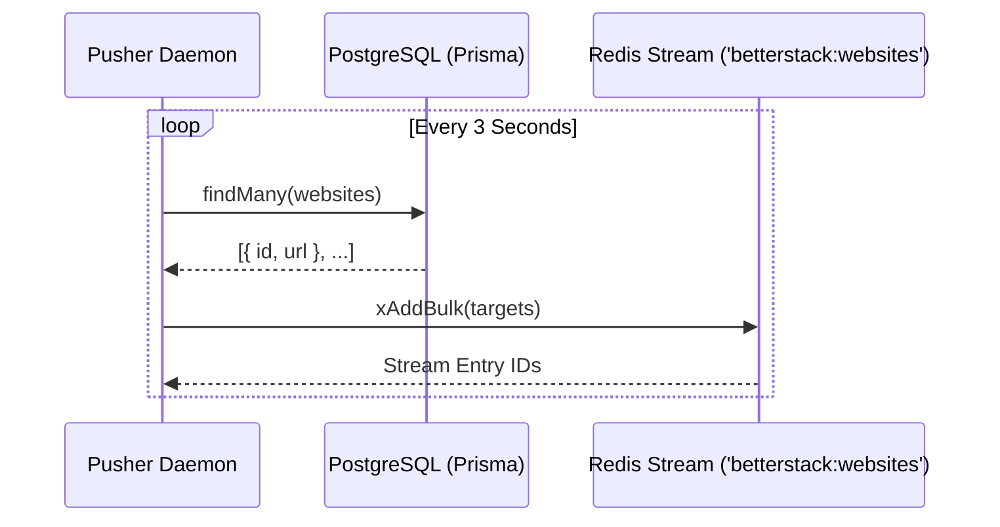

# @betterstack/pusher — Monitoring Job Dispatcher

The scheduled dispatching daemon responsible for querying active monitoring targets and streaming inspection payloads into Redis Streams.

## Architecture & Operation

1. Executes every 3 seconds via an asynchronous interval loop (`setInterval`).
2. Queries all active websites from PostgreSQL using `@repo/store` (`prismaClient.website.findMany`).
3. Bulk-enqueues jobs into the Redis Stream `betterstack:websites` via `@repo/redis` (`xAddBulk`).



## Running Locally

```bash
bun install
bun run index.ts
```
